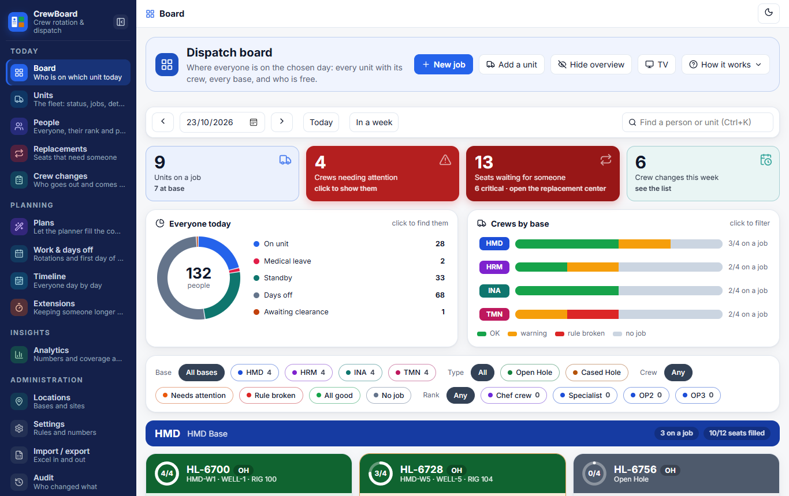
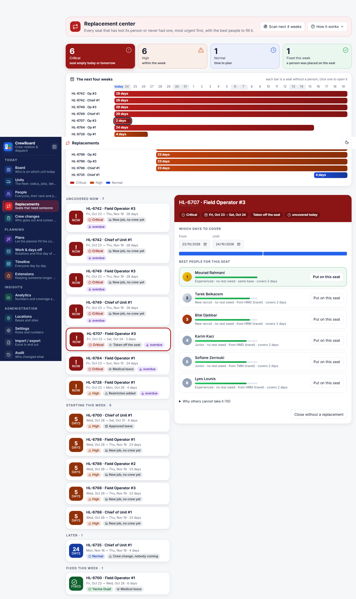
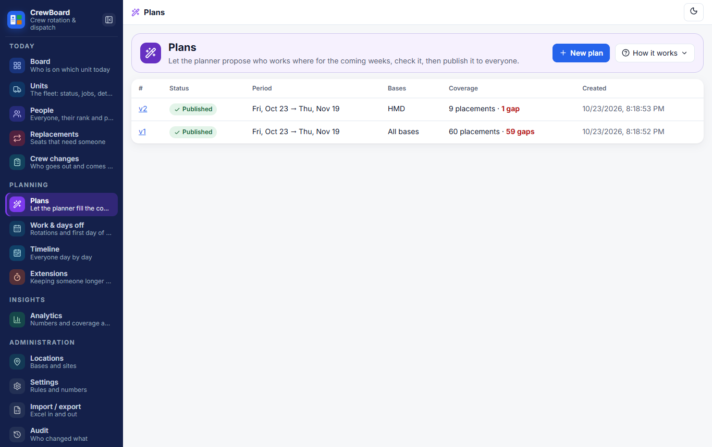
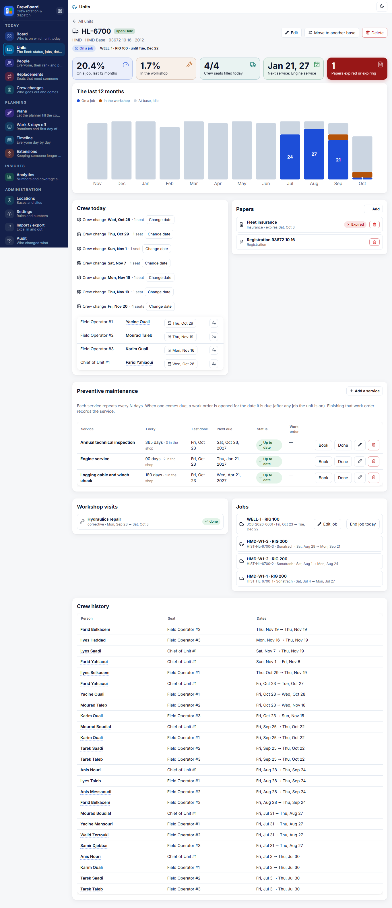
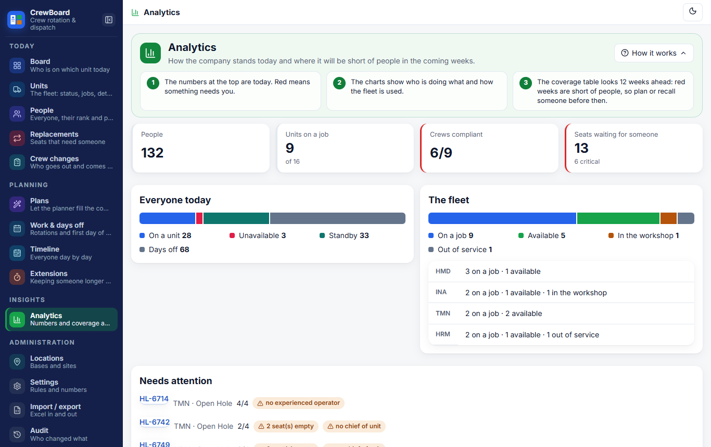
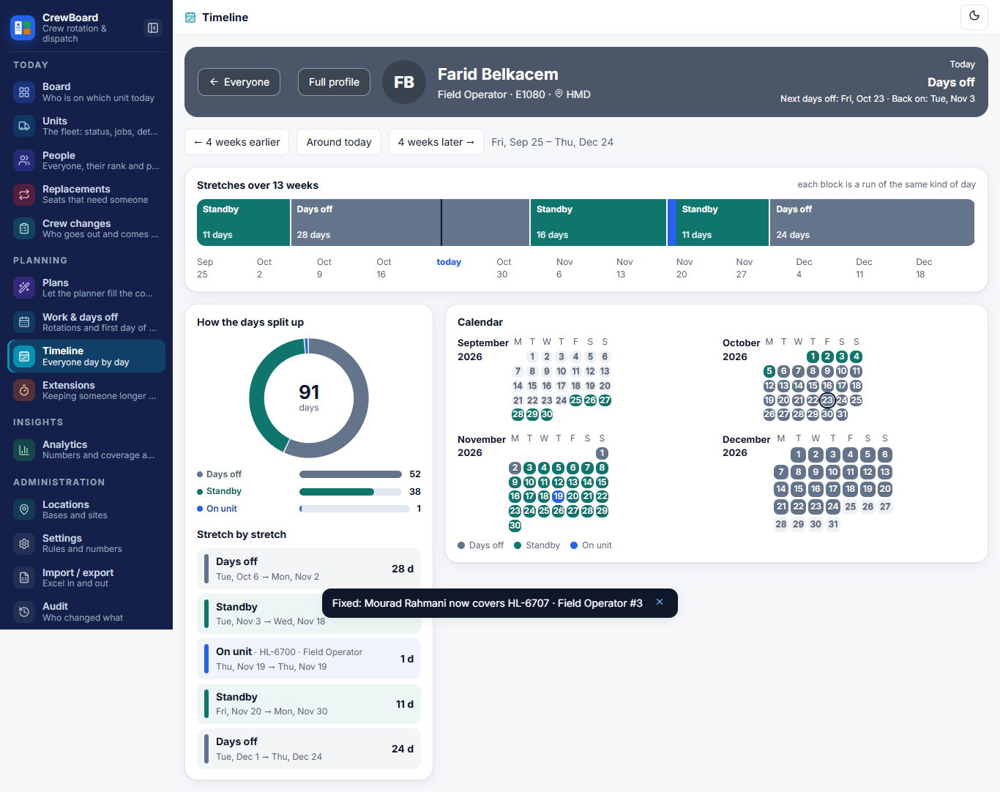
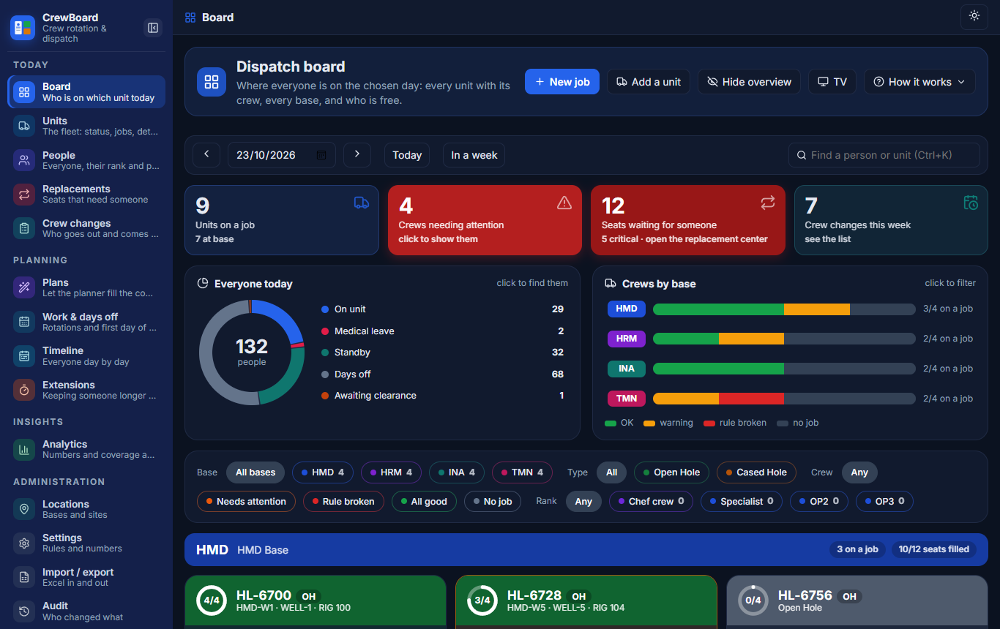
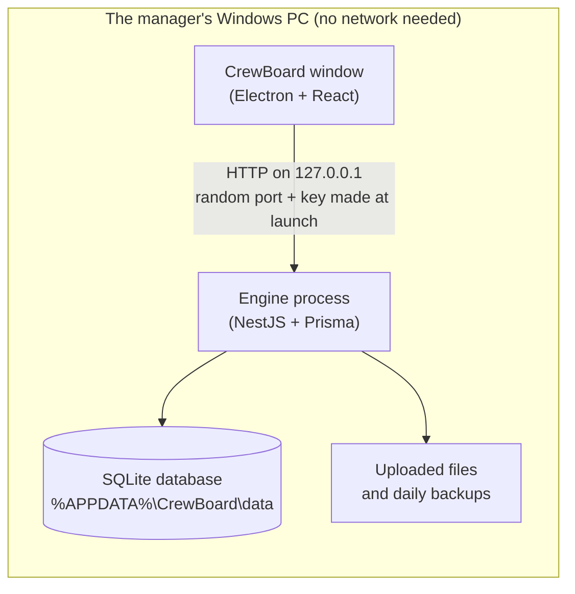

# CrewBoard

**Crew rotation and dispatch for oilfield service crews. One manager, one Windows PC, fully offline.**

CrewBoard answers the question a dispatch manager asks every morning: *who is on which unit today, who is missing, and who
can cover?* It knows each person's rotation, qualifications and rest days, checks every assignment against the crew
rules, and proposes the best replacement when a seat empties.

It installs like any Windows program, opens in its own window, keeps all its data in one file on the computer and never
needs the internet.



> **[Watch the 2-minute demo video](docs/media/crewboard-demo.mp4)** · [User manual](docs/manual/index.html) · [PDF manual](docs/manual/CrewBoard-manual.pdf)
>
> All screenshots show generated demo data, not real people.

Made by **Mohaned Gobbi**.

---

## What it does

| | |
|---|---|
| **Dispatch board** | Every unit with its crew (a chief and three operators), grouped by base, with a map, today's headcount and a red flag wherever a rule is broken or a seat is empty. Drag a person onto a seat, or press *Assign someone* to see the best matches. Look at any past or future day, or show it on a wall screen (TV mode). |
| **Replacement center** | Every uncovered seat as a task, most urgent first. For each one: the best candidates ranked, *why* each fits, and why the others were ruled out. One click puts someone on the seat; the task shows as *Fixed*. Tasks close to their date are escalated automatically. |
| **Planner** | Proposes who works where for the coming weeks, hardest seats first, scored on rest, fairness, qualifications and distance. Every choice is explained and unfillable seats come with ways to fix them. Plans go **draft, review, approved, published** and change nothing until published. |
| **Units and jobs** | The fleet with computed status (on a job, at base, in the workshop), jobs with open-ended dates, preventive maintenance that schedules itself, unit papers with expiry dates and a crew history. |
| **People** | Rank, partner, rotation pattern and first day of work. Status is *computed* from rotation, leave and assignments, never typed in. |
| **Crew changes, timeline, extensions** | Who leaves and who arrives in the next days, a day-by-day timeline of everyone, and extra days on a unit with limits, a balance of rest days owed and an approval step. |
| **Analytics** | A 90-day coverage forecast that shows shortages before they happen, key numbers, and a view of which crews need attention. |
| **Excel in and out, audit, backups** | Import people, units and bases from Excel (checked row by row before anything is written); export them back. Every change is logged with before and after. A backup of all data is made every day. |

<table>
<tr>
<td width="50%"><br><sub><b>Replacement center:</b> the best people for an empty seat, and why.</sub></td>
<td width="50%"><br><sub><b>Planner:</b> a proposed plan with the reason for every choice.</sub></td>
</tr>
<tr>
<td><br><sub><b>Unit page:</b> crew, jobs, maintenance and papers.</sub></td>
<td><br><sub><b>Analytics:</b> coverage forecast for the next 90 days.</sub></td>
</tr>
<tr>
<td><br><sub><b>Timeline:</b> one person's rotation, leave and assignments.</sub></td>
<td><br><sub><b>Dark mode</b>, remembered between sessions.</sub></td>
</tr>
</table>

## How it works

- **The rules are code, and the numbers are settings.** Crew size, the experience each crew needs, the longest stretch on a unit, extension limits and the weights of the planner all live in *Settings*, are applied to the next calculation and are logged when changed. The rules themselves are a pure TypeScript library (`apps/api/src/domain`) with no database access, covered by unit tests.
- **One validator for everyone.** Manual assignments, the planner, plan publishing and replacements all go through the same rule check, so they cannot disagree. Breaking a hard rule needs a written reason, which goes in the audit log.
- **Status is computed, never stored.** Whether someone is on a unit, on days off, on leave, on standby or awaiting clearance comes from their rotation, leave and assignments for that day.
- **Leave frees seats by itself.** When a person cannot work, their seat is released and a replacement task is opened with the right urgency; filling the seat closes the task.
- **Plans are drafts until published.** Publishing re-checks every assignment against today's facts and turns anything that no longer fits into a replacement task.

## Offline, private, one computer



- **No cloud, no accounts, no sign-in, no telemetry.** There is one user: the manager.
- The engine listens **only on the local machine**, on a random port, and answers only requests that carry a secret key made when the app starts, so no other program on the computer can use it.
- All data is one SQLite file plus the uploaded documents, in `%APPDATA%\CrewBoard\data`. A copy of both is made every day into `backups\` (the 14 newest are kept, then one per month), and *Settings → Back up now* makes one on demand. Uninstalling keeps the data.
- Fonts and maps are bundled; nothing is loaded from the internet.

## Install

**To use CrewBoard** you need a Windows 10 or 11 PC and the installer, `CrewBoard Setup <version>.exe` (about 140 MB). It installs for the current Windows user without administrator rights, offers to choose the folder, and adds Start menu and desktop shortcuts. Nothing else is required: no Node.js, no database server, no browser.

- The installer is **not code-signed**, so Windows may show *"Windows protected your PC"*. Choose **More info, then Run anyway**.
- Build the installer yourself with the steps below. An installer built with `npm run dist` also carries a snapshot of the data in `%APPDATA%\CrewBoard\data` of the building computer; on a PC that has no CrewBoard data yet, the first launch sets it up, and a PC that already has data keeps it untouched. Use `npm run dist:empty` to build an installer without data (for example for a public release).

### Build from source

Requirements: Windows, Node.js 20 or newer.

```bash
npm install                 # the API and the web app (npm workspaces)
cd desktop
npm install                 # Electron and electron-builder
```

Electron's binary comes from GitHub. If that download is unreliable, install with `ELECTRON_SKIP_BINARY_DOWNLOAD=1`,
download `electron-v45.0.0-win32-x64.zip` from the [Electron releases](https://github.com/electron/electron/releases)
and unzip it into `desktop/electron-dist`.

```bash
npm run dist:empty          # builds API + web, stages desktop/build/app, writes desktop/dist/CrewBoard Setup 1.0.0.exe
```

`npm run stage` followed by `npm start` runs the app from `desktop/build/app` without installing it.

## Develop

Run against a **throwaway** data folder. The seed fills it with generated people, units and bases (PowerShell):

```powershell
npm install
$env:DATA_DIR = 'C:\temp\crewboard-test'      # a throwaway folder, never the real data
cd apps/api
npm run build                                 # compiles the API and generates the Prisma client
npm run seed                                  # mock data: 4 bases, 16 units, 140 people
npm run start:dev                             # the API on http://127.0.0.1:3000, restarts on change
npm run demo                                  # (API running) a published plan and 14 planted scenarios
cd ../web; npm run dev                        # the screens on http://localhost:5173, proxying /api to the API
```

`npm run build` at the repository root builds the API and the web app, and `npm start` serves both on port 3000.

**Never run the seed, the demo, the smoke suites or the browser tests against real data**: they wipe or change it. Without `DATA_DIR`, CrewBoard uses `%APPDATA%\CrewBoard\data`.

### Tests

| | Command | What |
|---|---|---|
| Logic | `cd apps/api && npm test` | 83 unit tests for the rules, planner, status, spans, forecast and Excel sheets |
| API | `cd apps/api && npm run smoke` | 12 live suites (386 checks) against a running API on a seeded throwaway database |
| Browser | `cd apps/web && npm run e2e` | 14 Playwright tests of the main flows, plus a WCAG 2.1 AA audit of every screen in light and dark (`PW_CHANNEL=msedge` uses the installed Edge) |
| Types | `npm run typecheck` in `apps/api`, `npx tsc --noEmit -p tsconfig.app.json` in `apps/web` | |

The database is created and migrated by the engine itself at start (`apps/api/prisma/migrations`, applied by `src/prisma/migrate.ts`), so an installed copy needs no tooling.

## Technology

| Layer | Used |
|---|---|
| Desktop shell | Electron 45, packaged with electron-builder (NSIS installer) |
| Screens | React 19, TypeScript, Vite, dnd-kit (drag and drop), lucide icons, self-hosted Inter font |
| Engine | NestJS 12 on Express 5, TypeScript |
| Data | SQLite through Prisma 6, in WAL mode |
| Excel | ExcelJS |
| Tests | Vitest, Playwright, axe-core |

About 7,600 lines of engine and 7,100 lines of screens, 35 data models and 149 endpoints.

## Project layout

```
apps/api/       the engine
  src/domain/     pure rules, planner, status, forecast (no database); unit tested
  src/<module>/   one NestJS module per area: assignments, planning, replacements, board, calendar, employees,
                  units, jobs, fleet, extensions, leave, analytics, transfer (Excel), audit, backup, settings...
  prisma/         schema and migrations; seed.ts makes the demo data
  scripts/        smoke suites, the demo story, the migration and database-summary tools
apps/web/       the screens (React); e2e/ browser tests; e2e-manual/ makes the manual's screenshots and the demo video
desktop/        Electron main process, staging and installer scripts, the icon
docs/           manual (HTML and PDF), desktop-plan.md, original-plan.md, performance.md, media/
```

## Documentation

- [User manual](docs/manual/index.html) ([PDF](docs/manual/CrewBoard-manual.pdf)): every screen, step by step.
- [docs/desktop-plan.md](docs/desktop-plan.md): how the product became a single-user desktop app, step by step.
- [docs/original-plan.md](docs/original-plan.md): the original multi-user plan (historical).
- [PRODUCT.md](PRODUCT.md) and [DESIGN.md](DESIGN.md): who it is for and the design system.
- [docs/performance.md](docs/performance.md): timings at the demo size and at five times it.

## Current limits

- Windows only, one user, English only. The installer is unsigned.
- Leave, medical leave, per-person tasks and the what-if simulator exist in the engine (and are tested) but have no screen in this version; the manager handles an absence by unassigning or replacing from the seat.
- No automatic updates: install a newer installer over the old one (data is kept).

## Author

Made by **Mohaned Gobbi** · © 2026 Mohaned Gobbi
