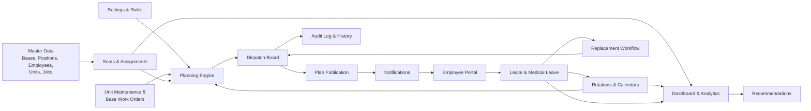
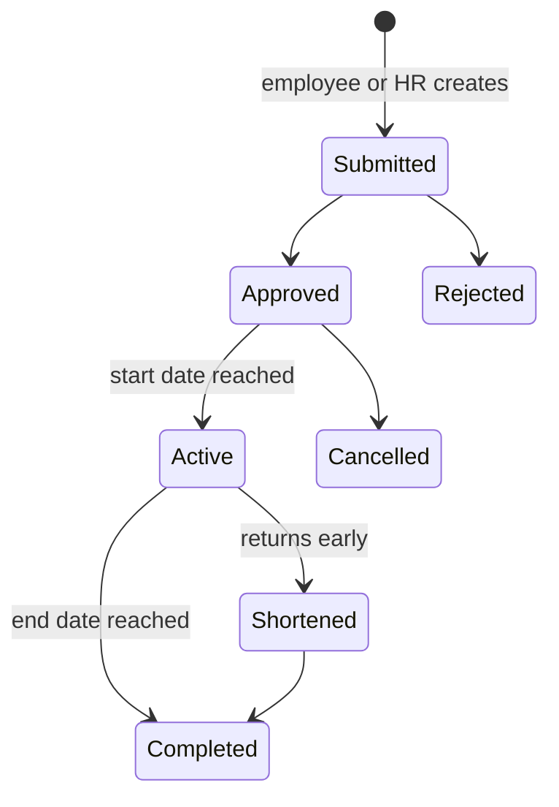
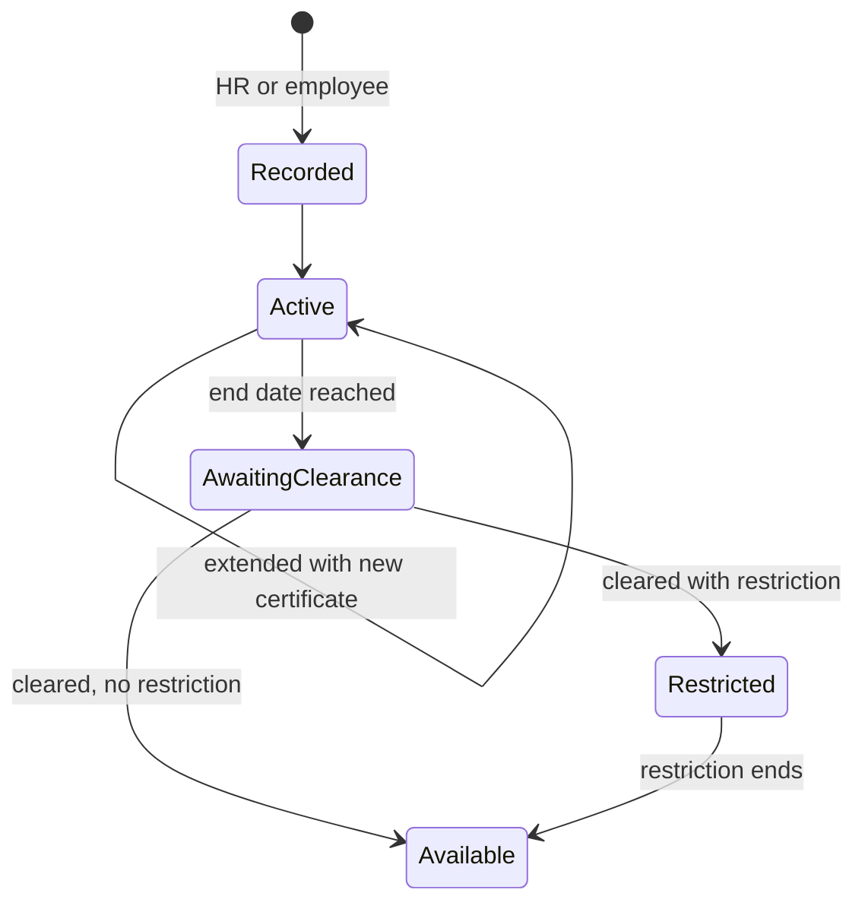
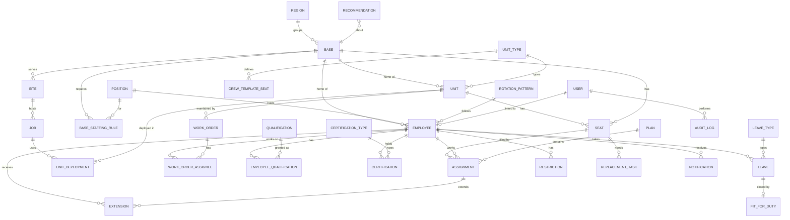
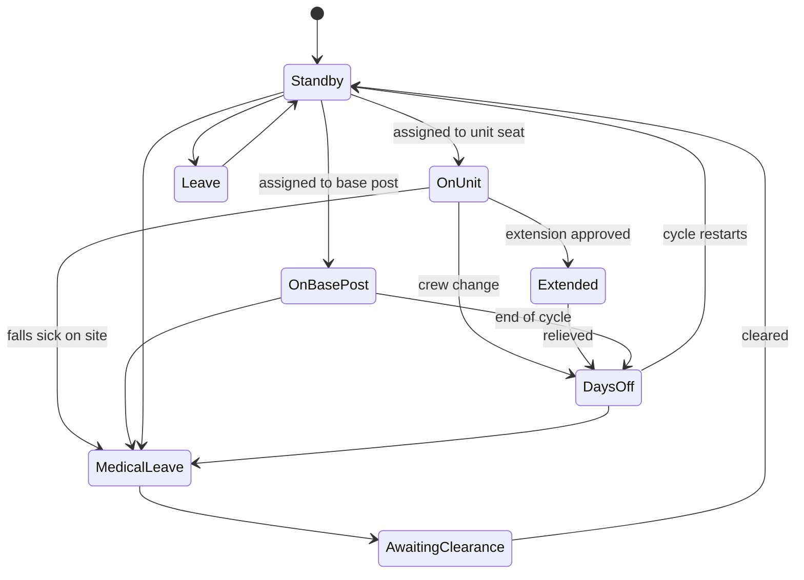

# CrewBoard — Crew Rotation, Dispatch & Base Staffing Platform

## Full Functional Work Plan — v3

> **Scope of this document:** the complete functionality of the platform, with all features and the full build plan.
> **Data:** the platform is built and demonstrated with **mock data** (section 28). Real company data will be connected later (section 31).
> **Design:** modern and simple to understand at first glance, for dispatchers, managers and field employees alike (section 27).
> **Rules:** every number in this document (crew size, rotation length, thresholds) is a **default value that can be changed in Settings**. None of it is hard-coded.

---

## Table of Contents

1. Problem & Objectives
2. Module Map
3. Roles & Permissions
4. Glossary
5. Locations & Bases
6. Positions & Workforce Structure
7. Employee Management
8. Units Management
9. Jobs (Wells / Rigs)
10. Seats & Assignments (core model)
11. Rotations & Calendars
12. Leave Management (incl. Medical Leave)
13. Extensions & Days-Off Balance
14. Dispatch Board
15. Planning Engine (auto-dispatch)
16. Replacement Workflow
17. Unit Maintenance & Base Work Orders
18. Employee Portal
19. Notifications
20. Admin Dashboard & Analytics
21. Recommendations Engine
22. Settings & Configuration
23. Audit Log & History
24. Data Model
25. Status Computation Logic
26. Screens Inventory
27. Design & User Experience
28. Mock Data Specification
29. Technical Architecture
30. Work Breakdown (Epics & Tasks)
31. Future: Real Data Integration
32. Assumptions to Confirm

---

## 1. Problem & Objectives

### Current situation
Dispatching is done on a physical whiteboard. It has a column for each base (HMD, In Amenas, Timimoun), unit magnet cards (Open Hole / Cased Hole) with crew name cards under them, handwritten job notes, an "At Work" column and a "Days Off" column.

### Problems
- Rotations are tracked manually, so people go on days off with no planned replacement.
- There is no forward view. Shortages are discovered at crew-change time.
- Shortages are covered by extending people on site. This causes extra days, fatigue and unfairness.
- Crew rules (crew size, experience, Open Hole / Cased Hole qualification) are checked from memory.
- Medical absences break the plan with no structured way to replace the person.
- Base staff (mechanics, technicians…) are not planned at all.
- There is no history, no statistics and no visibility for employees.

### Objectives
1. Show the full picture, today and in the future, for **every person, unit and base**.
2. **Check rules automatically** for unit crews and base staffing.
3. **Suggest plans and replacements automatically**, while the dispatcher can still edit everything manually.
4. Handle **all leave types, including medical leave**, and the replacements they trigger.
5. Give employees a **portal** with their schedule, replacement and notifications.
6. Give management **analytics, forecasts and recommendations**.
7. Be **modern and simple**: anyone who used the whiteboard understands the platform without training.

---

## 2. Module Map



---

## 3. Roles & Permissions

| Module / Action | Super Admin | Ops Manager | Dispatcher | HR / Admin Officer | Base Manager | Chief of Unit | Employee |
|---|---|---|---|---|---|---|---|
| Settings & rules | Full | View | — | — | — | — | — |
| Users & roles | Full | View | — | — | — | — | — |
| Bases & locations | Full | Full | View | View | View (own) | View | — |
| Positions catalog | Full | Full | View | Full | View | — | — |
| Employees | Full | Full | View + limited edit | Full | View (own base) | View (own crew) | Own profile |
| Units | Full | Full | Edit status | View | Edit (own base) | View (own unit) | — |
| Jobs | Full | Full | Full | — | View | View (own) | Own |
| Assignments / board | Full | Full | Full | View | Edit base posts (own base) | View | Own |
| Planning engine | Full | Full | Run + edit | — | Run for own base | — | — |
| Publish plan | Full | Approve | Submit | — | Submit (base posts) | — | — |
| Leave requests | Full | Approve | View dates only | Full (incl. medical) | Approve (own base staff) | View crew dates | Submit own |
| Medical certificates | Full | View | **No access** | Full | — | — | Own |
| Extensions | Full | Approve | Request | View | Request (own base) | Request | Acknowledge |
| Maintenance work orders | Full | Full | View | — | Full (own base) | Create | Mechanics: own tasks |
| Analytics | Full | Full | Operational only | HR stats | Own base | — | Own stats |
| Audit log | Full | View | — | View | — | — | — |

Roles can be combined. For example, a Base Manager can also be an employee with a portal.

---

## 4. Glossary

| Term | Definition |
|---|---|
| **Region** | A geographic grouping of bases (optional level) |
| **Base** | A physical company base where units are parked and maintained and where base staff work (HMD, In Amenas, Timimoun…) |
| **Site** | A well/rig location where a unit works on a job |
| **Unit** | A logging truck (`HL-xxxx`) of type Open Hole (OH) or Cased Hole (CH) |
| **Job** | A piece of work on a well/rig, with dates, done by one or more units |
| **Position** | A role definition (Field Operator, Mechanic, Chief of Unit…) |
| **Seat** | One slot to fill: either a **unit crew seat** (e.g. "HL-6790 – Field Operator #2") or a **base post** (e.g. "HMD Base – Mechanic #1") |
| **Crew template** | The set of seats a unit type requires |
| **Base staffing template** | The set of posts a base requires (minimum and target per position) |
| **Assignment** | A person placed on a seat for a period |
| **Rotation pattern** | A work/off cycle (e.g. 28/28) or a weekly schedule (e.g. 5 on / 2 off) |
| **Crew change** | The date an outgoing person leaves a seat and the incoming person takes it |
| **Back-to-back** | The person who alternates with you on the same seat; your default replacement |
| **Standby** | Present and available, but not on a seat |
| **Extension** | Days worked beyond the planned rotation end |
| **Days-off balance** | Off days owed to an employee (positive) or owed by them (negative) |
| **Medical leave** | Absence covered by a medical certificate |
| **Fit-for-duty clearance** | Confirmation that the employee can work again after medical leave, possibly with restrictions |
| **Restriction** | A temporary limit on what someone may be assigned to (e.g. "base posts only, no field work until date X") |
| **Gap** | A seat with no valid person for some dates |

---

## 5. Locations & Bases

### 5.1 Location hierarchy
```
Region (optional)
 └── Base  (HMD, In Amenas, Timimoun, …)
      └── Sites / well locations served by this base
```

### 5.2 Base fields
| Field | Notes |
|---|---|
| Name, short code | e.g. "HMD Base", `HMD` |
| Region | Optional |
| Address, wilaya / city | |
| **GPS coordinates** | Used for the map and for distance-based suggestions |
| Phone / contact person | |
| Base manager | Link to an employee |
| Unit parking capacity | Max number of units based here |
| Accommodation capacity | Beds for standby / transiting staff (optional) |
| Workshop facilities | Tags: mechanical workshop, electronics lab, wash bay… (optional) |
| Working hours / base schedule | Used for base staff weekly schedules |
| **Base staffing template** | Required posts per position (see 6.3) |
| Active / archived | |

### 5.3 Sites
- Fields: name, type (well / rig site / other), GPS, served-by base, client/operator, access notes, travel time from base.
- A site is usually created together with a Job.

### 5.4 Functionality
- Create, edit and archive bases and sites.
- Base detail page: units based here, staff assigned here, posts filled vs required, current jobs served, map.
- Transfer a unit or an employee to another home base (kept in history).
- Every base appears automatically as a column on the dispatch board.

---

## 6. Positions & Workforce Structure

### 6.1 Workforce categories
| Category | Works on | Examples |
|---|---|---|
| **Field crew** | Unit crew seats | Field Operator, Chief of Unit / Field Engineer, Field Driver |
| **Base staff** | Base posts | Mechanic, Electronics/Tool Technician, Welder, Shop Foreman, Storekeeper, Driver (base), HSE Officer |
| **Management / office** | Base posts or none | Base Manager, Dispatcher, Admin Officer, Operations Manager |

### 6.2 Position catalog (configurable)
| Field | Description |
|---|---|
| Name | e.g. Mechanic |
| Category | Field crew / Base staff / Management |
| Can fill unit seats | yes / no |
| Can fill base posts | yes / no |
| Default rotation pattern | e.g. Field Operator → 28/28, Mechanic → 5/2 weekly or 14/7 |
| Required qualifications | e.g. Mechanic → "Heavy vehicle mechanics" |
| Required certifications | e.g. Field Operator → H2S, first aid (list configurable) |
| Counts toward headcount reports as | grouping label |

Default seed positions: Field Operator, Chief of Unit, Field Engineer, Field Driver, Mechanic, Electronics Technician, Welder, Shop Foreman, Storekeeper, Base Driver, HSE Officer, Base Manager, Dispatcher, Admin Officer.

### 6.3 Base staffing templates
For each base and position you define:
- **Minimum** required at all times (hard rule). Example: HMD → Mechanic min 2.
- **Target** (soft rule). Example: HMD → Mechanic target 3.
- Optional **schedule window** (e.g. required only on working days).

The system creates the matching **base post seats**, and they are planned exactly like unit seats.

### 6.4 Employee work mode
Each employee has a **work mode**:
- **Field**: unit seats only.
- **Base**: base posts only, at their home base (or any base, if allowed).
- **Flexible**: both. For example, a field operator on standby can cover a base post, or a mechanic can travel with a unit for a job.

### 6.5 Base assignment functionality
- Assign an employee to a base post (manual drag & drop or engine suggestion).
- The base staffing panel shows each position as `filled / minimum / target` with red/orange/green colors.
- Base posts use the same calendar, leave, extension and replacement logic as unit seats.
- Mechanics and technicians get linked to **maintenance work orders** (section 17).

---

## 7. Employee Management

### 7.1 Profile fields
| Group | Fields |
|---|---|
| Identity | Employee no., full name, photo, date of birth (optional), phone, email, emergency contact, home city |
| Employment | Position, category (auto from position), work mode, hire date, contract type, home base, active/archived |
| Rotation | Rotation pattern, rotation anchor date (start of cycle), back-to-back partner |
| Skills | Qualifications (many, each with date obtained and who validated it) |
| Compliance | Certifications (many, with issue and expiry dates and an uploaded document) |
| Tags | Free custom tags |
| **Computed** | Seniority level, years of service, field days worked (year / total), base days worked, extension days, days-off balance, leave days taken per type, current status, current seat |
| Restrictions | Active restrictions (from fit-for-duty or manager), with end date |
| Notes | Manager-only notes |

### 7.2 Seniority (computed)
| Level | Default rule (configurable) |
|---|---|
| New Recruit | < 6 months **or** < 60 field days |
| Junior | < 2 years **or** < 300 field days |
| Experienced | ≥ 2 years **and** ≥ 300 field days |
| Senior | ≥ 5 years **and** ≥ 800 field days |

A manager can **override** the level (with a reason, logged). For example, they can promote an employee to Experienced early after a sign-off.

### 7.3 Functionality
- Employee list: search, filters (base, position, status, seniority, qualification, certification expiring, on leave), sort, export.
- Profile page tabs: **Overview**, **Calendar**, **Assignments history**, **Leave**, **Extensions & balance**, **Qualifications & certifications**, **Documents**, **Audit**.
- Bulk actions: change home base, change rotation pattern, add tag.
- Archive an employee (leaving the company) and release their future assignments automatically, which creates replacement tasks.
- New-recruit onboarding checklist (certifications to obtain, mentor pairing).

---

## 8. Units Management

### 8.1 Unit fields
| Field | Notes |
|---|---|
| Unit code | `HL-6790` |
| Type | Open Hole / Cased Hole (more types configurable) |
| Home base | |
| Current location | Base or site (computed from deployment) |
| **Status** | Available at base, Deployed (on job), In transit, Under maintenance, Out of service |
| Crew template | Taken from the unit type, can be overridden per unit |
| Vehicle info | Plate, model, year, mileage (optional) |
| Equipment notes | Free text for now; full equipment module is a future extension |
| Photo | |

### 8.2 Crew templates (defaults, configurable)
| Unit type | Seats |
|---|---|
| Open Hole | 1 Chief of Unit · 3 Field Operators (≥1 Experienced, all OH-qualified) · 0–1 Field Driver |
| Cased Hole | 1 Chief of Unit · 3 Field Operators (≥1 Experienced, all CH-qualified) · 0–1 Field Driver |

### 8.3 Functionality
- Unit list with status chips and filters (type, base, status, compliance problems).
- Unit page: current crew and job, crew history, job history, maintenance history, utilization stats.
- Change status. Setting "Under maintenance" opens a work order (section 17), and crew seats on a unit in maintenance become optional.
- Transfer a unit to another base.

---

## 9. Jobs (Wells / Rigs)

| Field | Notes |
|---|---|
| Job reference | Auto number |
| Well name | e.g. `HGAS-7` |
| Rig name | e.g. `SPEC 232` |
| Client / operator | |
| Site | Link to a site (GPS) |
| Service type | Open Hole / Cased Hole |
| Planned start / end | |
| Actual start / end | |
| Status | Planned, Active, Completed, Cancelled |
| Units deployed | One or more units with dates |

Functionality:
- Create a job and deploy a unit to it. The unit status becomes Deployed and its crew seats become **required** for those dates.
- Job timeline, job list, and job history per well/rig.
- Ending a job sends the unit back to "Available at base" (or "In transit").
- The engine checks the job's service type against the unit type (OH job on CH unit → warning).

---

## 10. Seats & Assignments (core model)

All planning is built on one idea: **seats are slots to fill, and assignments put people in seats for a date range.**

```
Seat
 ├─ holder: Unit (crew seat) or Base (base post)
 ├─ position required (e.g. Field Operator)
 ├─ requirements (qualification, min seniority, certifications)
 ├─ required? (unit deployed → yes; unit at base → optional; base min → yes; base target → optional)
 └─ index (#1, #2, #3)

Assignment
 ├─ employee → seat
 ├─ start date, planned end, actual end
 ├─ type: normal | replacement | extension cover | temporary cover
 ├─ status: draft | confirmed | active | completed | cancelled
 ├─ replaces (previous assignment)
 └─ plan (which plan version created it)
```

Crew-level rules such as "≥ 1 Experienced per crew" are checked across all seats of the same unit.

Functionality:
- Assign, unassign, move, or swap two people (each action is checked against rules and logged).
- Split an assignment (e.g. someone leaves mid-rotation).
- Every assignment change shows its **impact preview** before saving: rule violations, the extension it causes, the days-off balance change.

---

## 11. Rotations & Calendars

### 11.1 Rotation pattern types
| Type | Example | Used by |
|---|---|---|
| Cycle | 28 on / 28 off, 21/21, 14/14, 6 weeks / 3 weeks | Field crew, some base staff |
| Weekly schedule | 5 on / 2 off (Sun–Thu), 6/1 | Base staff, office |
| Custom | Manually drawn calendar | Exceptions |

Pattern fields: name, type, days on, days off, travel days (counted as work / off / separate, configurable), and the anchor date per employee.

### 11.2 Calendar generation
- The system generates each employee's **expected calendar** (on/off) 12 months ahead from the pattern and anchor date.
- Approved leave, extensions and assignments are layered on top to produce the **actual calendar**.
- Changing someone's pattern or anchor date regenerates their future calendar and flags affected assignments.

### 11.3 Views
- **Personal calendar** (month view, color per status).
- **Team timeline / Gantt**: rows = employees (grouped by base / position / unit), columns = days, colored blocks. It supports drag to adjust and zoom from week to quarter.
- **Crew-change list**: all crew changes in the next 7 / 14 / 30 days with outgoing → incoming person, status (confirmed / suggested / missing) and travel notes.
- **Base roster**: per base, each post per day.

---

## 12. Leave Management (incl. Medical Leave)

### 12.1 Leave types (configurable)
| Type | Needs approval | Document | Counts as | Notes |
|---|---|---|---|---|
| Annual leave | Yes | — | Leave | Deducted from annual entitlement |
| **Medical leave** | Recorded by HR / validated | **Medical certificate (required)** | Medical absence | See 12.3 |
| Recovery days | Yes | — | Leave | Consumes days-off balance from extensions |
| Training | Yes | Training reference | Training | Can be linked to a certification |
| Exceptional / family leave | Yes | Optional | Leave | Marriage, birth, bereavement… |
| Maternity / paternity | Yes | Required | Leave | |
| Unpaid leave | Yes | — | Leave | |
| Unjustified absence | Recorded by manager | — | Absence | For reporting |

### 12.2 General leave workflow


When leave is approved:
1. The employee's calendar is updated.
2. The system scans **every seat they hold or were planned for** during the leave dates.
3. Each affected seat creates a **replacement task** (section 16).
4. The engine proposes candidates immediately.

### 12.3 Medical leave (specific behavior)
**Creation**
- The employee submits it from the portal with a certificate photo or PDF, **or** HR/manager enters it on their behalf (common when someone calls in sick from site).
- Fields: start date, expected end date, certificate upload, issuing doctor/clinic (optional), notes. **There is deliberately no diagnosis field.**

**Privacy**
- The certificate and notes are visible only to **HR, Ops Manager and the employee**.
- The dispatcher and crewmates only see **"Unavailable"** with dates (whether the reason shows is configurable).
- Medical statistics are shown **only as aggregates** (by base / month), never as a ranking of individuals.

**Impact handling**
- If the employee is **currently on a unit or base post**, an **urgent** replacement task is created for today.
- If the leave starts during their **days off**, their next on-period assignments are flagged.
- A setting decides whether off-days lost to medical leave are **credited back** or not.

**Extension of medical leave**
- HR can extend the end date with a new certificate. Affected future seats are flagged again, and the engine re-suggests.

**Return to work: fit-for-duty clearance**
- When medical leave ends, the employee moves to **"Awaiting clearance"** and can't be assigned until HR confirms clearance (the requirement is configurable per leave length, e.g. only for leave > 7 days).
- Clearance can include **restrictions**: e.g. "base posts only for 14 days" or "no field work until date X". The engine respects them, so the person can fill a base post but not a unit seat.

**Long-term absence**
- Medical leave longer than a threshold (default 30 days) is marked **long-term**. It is counted in the forecast and can trigger a recommendation (temporary reinforcement, hiring).



### 12.4 Leave functionality summary
- Leave calendar per base (who is absent when).
- Overlap warning: "3 Experienced CH operators off in the same week".
- Annual entitlement tracking: days entitled, taken, remaining.
- Leave balance shown in the portal.

---

## 13. Extensions & Days-Off Balance

- An extension is an **explicit request**: employee, seat, number of days, reason (no replacement / urgent job / replacement late / medical replacement…).
- Workflow: requested (dispatcher / base manager / chief) → approved (ops manager) → notified → **acknowledged by employee**.
- Approval automatically:
  - extends the current assignment,
  - shifts their next on-period (or not, depending on the setting),
  - adds days to their **days-off balance**.
- Limit setting: max extension days per rotation and per quarter. Beyond the limit, the request needs a manager override with a reason.
- Recovery: the balance can be consumed with "Recovery days" leave or added automatically to the next off-period.
- Reports: extensions by employee / base / reason / month.

---

## 14. Dispatch Board

The main daily screen. It reproduces the whiteboard digitally.

### 14.1 Field view
- **One column per base**. Inside each, unit cards (green OH / yellow CH) with crew seats underneath and the job label (well / rig).
- Side columns: **Standby**, **Days off**, **Leave**, **Medical / Unavailable**, **Training**, **Awaiting clearance**.
- Unit card badges: `3/3 ✓`, `2/3 ⚠`, `No experienced ⚠`, `Missing CH qualification ⚠`, `Cert expired ✗`, `Crew change in 2 days`.
- **Drag & drop** people between seats and columns. The rule check runs live, and blocking violations require an override reason.

### 14.2 Base staff view
- Each base shows a staffing panel: rows = positions, cells = people, plus a `filled / min / target` indicator.
- Mechanics show their current work order.
- Drag & drop works the same way.

### 14.3 Common controls
- **Date selector**: see the board on any past date (history) or future date (plan).
- Filters: base, unit type, position, problems only.
- Search a person or unit, which highlights them on the board.
- Toggle between **Live** (published) and **Draft plan** layers.
- Full-screen **TV mode** for the office screen (auto-refresh).
- Print / export the board as PDF.

---

## 15. Planning Engine (auto-dispatch)

### 15.1 Inputs
- Seats requiring people over the period: crew seats of deployed units, and base posts from staffing templates.
- Employee calendars (rotation + leave + extensions + restrictions + clearance status).
- Qualifications, certifications (validity on each date), seniority.
- Rule settings and weights.

### 15.2 Hard rules (cannot be broken without override)
1. Required seats filled (unit crew counts; base minimums).
2. ≥ 1 Experienced (configurable level) per unit crew.
3. ≥ 1 Chief of Unit per deployed unit.
4. Required qualification for the unit type / base position.
5. Mandatory certifications valid for every day of the assignment.
6. Person available: not off, not on leave, not on medical leave, not awaiting clearance.
7. Respect active **restrictions** (e.g. base-only).
8. One seat per person per day.
9. Max consecutive working days / max extension days.
10. Work mode respected (Field / Base / Flexible).

### 15.3 Soft rules (scored)
| Rule | Purpose |
|---|---|
| Prefer back-to-back partner | Stable pairs |
| Fairness: highest days-off balance gets relief first; lowest extension count gets extended first | Equal load |
| Same base | Less travel |
| Crew stability: don't change more than 1–2 crew members on the same day | Continuity on the job |
| Seniority mix: avoid 1 experienced + 2 new recruits when an alternative exists | Safety and training |
| Pair new recruits with seniors | Mentoring |
| Base staff for base posts before flexible field staff | Keep field staff for units |
| Employee preferences (requested days off, swap requests) | Satisfaction |

### 15.4 Algorithm
1. Build availability for each employee and day.
2. List open seats (crew changes, empty seats, seats freed by leave/medical leave/archiving).
3. Sort seats **hardest first** (fewest valid candidates).
4. Filter candidates with the hard rules.
5. Score with weighted soft rules (weights in Settings).
6. Assign the best candidate, update availability, and continue.
7. Seats with no candidate become **gaps**, each with ranked fix options:
   - take someone from standby (other base, with travel),
   - use a flexible employee from base staff,
   - extend the outgoing person (shows the cost in days),
   - move a person from a unit at base (not deployed),
   - postpone a non-urgent leave (manager decision),
   - flag a hiring need.
8. The output is a **draft plan**. Each choice carries an **explanation** ("back-to-back partner · Experienced · balance +4 days").

Advanced optimizer (later stage of the build): a constraint solver (Google OR-Tools CP-SAT) optimizes the whole period at once. Its objective is to minimize extensions and gaps while maximizing fairness. It sits behind the same interface.

### 15.5 Modes
- **Plan a period** (e.g. next 4 weeks, all bases or one base).
- **Fill one seat** (quick suggestion list of the top 5 candidates).
- **Repair plan** (re-plan only what was broken by a new event, keeping everything else).
- **What-if simulation** (e.g. deploy 2 more units, someone resigns, 3 people on medical leave). It runs on a copy and never touches the live plan.

### 15.6 Plan lifecycle
`Draft → Under review → Approved → Published`. Publishing creates the assignments as confirmed and sends notifications. Every published plan is versioned, and you can compare version N with N-1.

---

## 16. Replacement Workflow

Any event that empties a seat creates a **Replacement Task**:

| Trigger | Urgency |
|---|---|
| Medical leave while on seat | Critical (today) |
| Medical leave starting within 7 days | High |
| Approved annual / other leave | Normal |
| Normal crew change with no incoming person | Based on days left |
| Employee archived / resigned | Based on dates |
| Restriction added (e.g. base-only) while on a unit seat | High |
| Certification expiring during assignment | Based on expiry date |
| Unit deployed to a new job | Based on job start |

Task lifecycle: `Open → Candidate proposed → Candidate confirmed → Closed` (or `Escalated` if no candidate before the deadline).

Replacement center screen:
- List of all open tasks sorted by urgency, with countdown.
- One click to see the top candidates and confirm.
- Escalation to the ops manager when deadlines are close.
- Each confirmed replacement notifies the incoming person, the outgoing person, the chief of unit / base manager and the dispatcher.

---

## 17. Unit Maintenance & Base Work Orders

This module connects units to base staff (mechanics, technicians).

### 17.1 Work order
| Field | Notes |
|---|---|
| Unit | |
| Base | Where the work is done |
| Type | Preventive, corrective, inspection, tool repair, other |
| Description, priority | |
| Assigned to | Mechanic(s) / technician(s) |
| Planned start / expected return date | |
| Status | Open, In progress, Waiting parts, Done, Cancelled |
| Notes, photos | |

### 17.2 Functionality
- Opening a work order sets the unit to **Under maintenance**. The unit is shown as unavailable for jobs until the expected return date.
- The engine and dashboard account for units in maintenance (fewer deployable units → fewer required crew seats).
- Mechanics see their tasks in the portal and update status.
- Preventive maintenance schedule per unit (e.g. every X days or km) creates work orders automatically.
- Stats: unit downtime, maintenance load per base, mechanic workload.

---

## 18. Employee Portal

Mobile-first. Available in French, Arabic (right-to-left) and English.

| Section | Content |
|---|---|
| **Today** | My status, my seat (unit + job/site, or base post), my crewmates / base team, my chief or base manager |
| **My calendar** | Month view with on / off / leave / medical / training; next crew change date; next days off |
| **My replacement** | Who replaces me and when; whom I replace |
| **Notifications** | Plan changes, extension requests (with **Acknowledge**), leave decisions, certification expiry, manager messages |
| **Requests** | Annual leave, **medical leave with certificate upload**, recovery days, swap with a colleague (colleague accepts → manager approves) |
| **My work orders** | Mechanics and technicians only |
| **My stats** | Field/base days worked this year, extension days, days-off balance, leave balance |
| **My profile** | Contact info (editable), qualifications, certifications with expiry |

---

## 19. Notifications

Channels: in-app and email first; SMS/WhatsApp later. Each user sets their preferences per notification type.

| Event | Recipients | Needs acknowledgement |
|---|---|---|
| Plan published / my assignment changed | Employee | Yes |
| Crew change in 48 h | Incoming + outgoing employee, chief | No |
| Replacement confirmed | Incoming, outgoing, chief / base manager | No |
| Extension requested / approved | Employee, manager | **Yes (employee)** |
| Leave submitted | Approver | No |
| Leave approved / rejected | Employee | No |
| Medical leave recorded | HR, dispatcher (without reason), base manager | No |
| Awaiting fit-for-duty clearance | HR | No |
| Restriction added / ended | Employee, dispatcher | No |
| Certification expiring (60 / 30 / 7 days) | Employee, HR | No |
| Replacement task critical / escalated | Dispatcher, ops manager | No |
| Base below minimum staffing | Base manager, ops manager | No |
| Unit back from maintenance | Dispatcher | No |
| Manager broadcast message | Selected group | Optional |

---

## 20. Admin Dashboard & Analytics

### 20.1 Dashboard pages
1. **Overview (today)**: headcount by status; units by status per base; non-compliant crews; base posts below minimum; open replacement tasks by urgency; crew changes in the next 7 days.
2. **Coverage forecast**: required vs available people per day for the next 90 days, per base and per position/qualification; heatmap (days × bases) with gaps in red.
3. **People & fairness**: extension days distribution; days-off balance ranking; field days per employee; seniority mix per base.
4. **Leave & absence**: leave by type per month; absence rate per base; medical leave **aggregated only**; long-term absences count; leave overlaps.
5. **Units & maintenance**: utilization, downtime, jobs per unit, maintenance per base.
6. **Base staffing**: filled vs minimum vs target per base and position over time.
7. **Compliance**: certifications expiring; people blocked by expired certifications.
8. **Map**: Algeria map with bases, active sites, unit pins colored by status, and crew counts on hover.

### 20.2 KPI catalog
| KPI | Formula |
|---|---|
| Crew compliance rate | compliant deployed units / deployed units |
| Seat fill rate | filled required seats / required seats |
| Replacement lead time | avg days between replacement confirmation and crew change |
| Unplanned extension days | sum of extension days in period |
| Extension fairness | standard deviation of extension days per employee |
| Avg days-off balance | mean balance across employees |
| Absence rate | absent person-days / scheduled person-days (per base, per type) |
| Medical absence rate | medical leave person-days / scheduled person-days (aggregate only) |
| Coverage ratio (forecast) | available qualified people / required seats per day |
| Rotation staffing ratio | employees per seat (e.g. 2.0 for 28/28) vs actual |
| Unit utilization | days deployed / days in period |
| Unit downtime | days under maintenance / days in period |
| Base staffing rate | filled base posts / minimum posts |
| Certification compliance | employees with all mandatory certs valid / active employees |

All charts can be filtered by base, position, unit type and period, and exported (PNG / Excel / PDF).

---

## 21. Recommendations Engine

Rule-based and explainable. Each recommendation shows its **data behind it** and a suggested action.

| Recommendation | Trigger |
|---|---|
| Recruit N [position/qualification] for [base] by [date] | Forecast coverage ratio < 1 for that profile on repeated days |
| Transfer N people from Base A to Base B | A has standby surplus while B has gaps in the same period |
| Prioritize relief for employee X | Days-off balance above threshold |
| Spread leave requests | Too many people of the same profile off at once |
| Train N operators for Cased Hole | CH gaps repeat while OH has a surplus |
| Prepare promotions to Experienced | N employees reach the threshold soon (pipeline) |
| Renew certifications | M people will be blocked within 30 days |
| Reinforce mechanics at base | Work order backlog / downtime above threshold |
| Temporary reinforcement for long absence | Long-term medical leave on a scarce profile |

Recommendations can be marked **Accepted / Dismissed / Snoozed**, and that is logged.

---

## 22. Settings & Configuration

- **Organization**: company name, logo, languages, time zone, week start.
- **Rules**: crew size per unit type, min experienced per crew, chief required, max consecutive days, max extension days, seniority thresholds, clearance requirement after medical leave (days), long-term absence threshold, medical days credit policy, travel days policy.
- **Engine weights** for soft rules.
- **Catalogs**: positions, qualifications, certification types (mandatory per position), leave types, unit types, rotation patterns, job service types, work order types, tags.
- **Base staffing templates** per base.
- **Notifications**: templates (FR/AR/EN), channels, reminders timing.
- **Users & roles**: create users, link to employees, assign roles and base scopes.
- **Data**: import/export, mock data reset (in demo mode).

---

## 23. Audit Log & History

- Every create/update/delete stores: user, timestamp, entity, before/after values and reason (if override).
- **Board time machine**: rebuild the board for any past date.
- Plan versions with diff view.
- Assignment history per employee, unit and base.
- Access log for medical documents (who viewed what and when).

---

## 24. Data Model



### Main entities
| Entity | Key fields |
|---|---|
| **Region** | id, name |
| **Base** | id, code, name, region_id, address, city, lat, lng, phone, manager_id, unit_capacity, bed_capacity, facilities[], schedule, active |
| **Site** | id, name, type, lat, lng, base_id, client, travel_time_hours |
| **Position** | id, name, category, can_fill_unit_seat, can_fill_base_post, default_rotation_id, required_qualification_ids[], required_cert_type_ids[] |
| **BaseStaffingRule** | base_id, position_id, min_count, target_count, schedule_window |
| **Employee** | id, employee_no, names, photo, phone, email, emergency_contact, home_city, position_id, work_mode, hire_date, contract_type, home_base_id, rotation_pattern_id, rotation_anchor_date, back_to_back_id, seniority_override, active |
| **Qualification / EmployeeQualification** | name; employee_id, qualification_id, obtained_at, validated_by |
| **CertificationType / Certification** | name, mandatory_for_positions[]; employee_id, type_id, issued_at, expires_at, document_url |
| **UnitType / CrewTemplateSeat** | name; unit_type_id, position_id, count, required_qualification_id, min_seniority |
| **Unit** | id, code, unit_type_id, home_base_id, status, plate, model, year, notes |
| **Seat** | id, holder_type (unit / base), holder_id, position_id, index, requirements (json), required_flag |
| **Job** | id, ref, well_name, rig_name, client, site_id, service_type, planned_start, planned_end, actual_start, actual_end, status |
| **UnitDeployment** | unit_id, job_id, start, end |
| **Assignment** | id, employee_id, seat_id, start, planned_end, actual_end, type, status, replaces_id, plan_id |
| **Plan** | id, scope (bases), period_start, period_end, status, version, created_by, approved_by |
| **RotationPattern** | id, name, type, days_on, days_off, weekly_mask, travel_days_policy |
| **LeaveType / Leave** | name, needs_approval, needs_document, category; employee_id, type_id, start, end, status, document_url, entered_by, approved_by, notes (restricted) |
| **FitForDuty** | leave_id, cleared_at, cleared_by, restriction_id |
| **Restriction** | employee_id, kind (base_only / no_field / no_night / custom), start, end, source |
| **Extension** | assignment_id, employee_id, days, reason, status, requested_by, approved_by, acknowledged_at |
| **ReplacementTask** | seat_id, from_date, to_date, trigger, urgency, status, candidate_id, deadline |
| **WorkOrder / WorkOrderAssignee** | unit_id, base_id, type, priority, description, planned_start, expected_return, status; work_order_id, employee_id |
| **Notification** | user_id, type, payload, channel, read_at, acknowledged_at |
| **Recommendation** | type, base_id, data (json), suggested_action, status |
| **Setting** | key, value |
| **User / Role / UserRole** | login, password hash, linked employee; role, base scope |
| **AuditLog** | user_id, entity, entity_id, action, before, after, reason, at |

---

## 25. Status Computation Logic

An employee's status on a date is **never typed by hand**. It is computed in this priority order:

1. Archived → **Inactive**
2. Medical leave active → **Medical leave**
3. Other approved leave active → **Leave (type)**
4. Medical leave ended, clearance pending → **Awaiting clearance**
5. Assignment covering the date on a unit seat → **On unit** (+ **Extended** if past planned end)
6. Assignment on a base post → **On base post**
7. Rotation calendar says "on" → **Standby**
8. Rotation calendar says "off" → **Days off**

Restrictions are shown as a badge on top of the status.



Unit status is computed the same way: active work order → Under maintenance; deployment covering the date → Deployed; otherwise → Available at base (or a manual Out of service).

---

## 26. Screens Inventory

| # | Screen | Main elements |
|---|---|---|
| 1 | Login / password reset | |
| 2 | Dispatch board – Field view | Base columns, unit cards, side status columns, date selector, live rule badges |
| 3 | Dispatch board – Base staff view | Staffing panels per base, filled/min/target |
| 4 | Timeline / Gantt | Employees × days, grouping, zoom, drag |
| 5 | Crew-change list | Next 7/14/30 days, status per change |
| 6 | Replacement center | Urgent tasks, candidates, confirm |
| 7 | Plan builder | Period & scope, run engine, review suggestions with explanations, gaps & fix options, submit/approve/publish, version diff |
| 8 | What-if simulator | Scenario inputs, result comparison |
| 9 | Employees list | Filters, bulk actions, export |
| 10 | Employee profile | Tabs: overview, calendar, history, leave, extensions, qualifications/certs, documents, audit |
| 11 | Units list / Unit page | Status, crew, jobs, maintenance, utilization |
| 12 | Bases list / Base page | Units, staff, staffing template, map, jobs served |
| 13 | Sites & Jobs | List, job detail, deploy unit |
| 14 | Leave management | Requests inbox, leave calendar, medical leave panel (HR), clearance queue |
| 15 | Extensions | Requests, approvals, balances |
| 16 | Work orders | Board per base (open / in progress / waiting parts / done), detail |
| 17 | Dashboard (8 pages) | See section 20 |
| 18 | Recommendations | List, details, accept/dismiss |
| 19 | Map | Bases, sites, units |
| 20 | Notifications center | |
| 21 | Settings (all sections) | See section 22 |
| 22 | Users & roles | |
| 23 | Audit log | Filters by entity/user/date |
| 24 | Portal – Today | |
| 25 | Portal – My calendar | |
| 26 | Portal – Notifications | Acknowledge actions |
| 27 | Portal – Requests | Leave, medical (upload), swap |
| 28 | Portal – My work orders | Mechanics/technicians |
| 29 | Portal – My stats & profile | |
| 30 | TV mode board | Full screen, auto-refresh |

---

## 27. Design & User Experience

### 27.1 Design goal
The platform must look **modern** and be **simple to understand at first glance**, for every user:
- a dispatcher who uses it all day on a desktop,
- a manager who opens the dashboard a few times a day,
- a field operator who checks their schedule on a phone, sometimes with a weak connection.

The rule for every screen: **someone who has only ever used the whiteboard should understand it without training.**

### 27.2 UX principles
1. **The board stays familiar.** Same mental model as the whiteboard: bases as columns, unit cards, people under them. It has a cleaner look and adds the extra powers.
2. **One main action per screen.** The primary button is always visible and in the same place; secondary actions go in a "more" menu.
3. **Plain words, no jargon.** "Needs a replacement" rather than "Replacement task: Open"; "Back on" rather than "Rotation start".
4. **Status = icon + color + text.** Never color alone (color-blind users, screen glare outdoors).
5. **Problems first.** Every list and board can be filtered to "only what needs my attention". Red badges are rare, so they get noticed.
6. **Details in drawers, not new pages.** Clicking a person, unit or task opens a side drawer, so the user never loses their place on the board.
7. **Undo instead of "Are you sure?"** for reversible actions (move, assign, swap). Confirmation dialogs are kept only for publishing, overrides and deletions.
8. **Explain the machine.** Every automatic suggestion shows a short "why" line.
9. **Helpful empty states.** An empty screen says what to do next ("No crew yet: drag operators here or click Suggest crew").
10. **Fast.** The board is usable in under 2 seconds and drag & drop stays smooth (60 fps) with the full mock data volume.
11. **Search everything.** A command palette (`Ctrl + K`) finds any person, unit, base or job and runs actions ("assign", "open profile").

### 27.3 Visual language
| Element | Choice |
|---|---|
| Style | Clean, airy, rounded cards, soft shadows, lots of white space, light **and** dark mode |
| Base palette | Neutral grays (slate) + one brand accent color |
| Domain colors (same everywhere) | **Open Hole = green**, **Cased Hole = amber/yellow** (matches the trucks' magnets today) |
| Typography | **Inter** (Latin) + **IBM Plex Sans Arabic** or **Cairo** (Arabic); big bold numbers for KPIs, small muted labels |
| Icons | Lucide (one consistent icon set) |
| Spacing & radius | 4/8 px spacing scale, 12–16 px card radius |
| Density | "Comfortable" by default, "Compact" mode for dispatchers who want more on screen |
| Glass effect | Light frosted glass only on a few floating elements (top bar, command palette, TV-mode overlays), always readable (see 27.5) |

**Status colors and icons**
| Status | Color | Icon |
|---|---|---|
| On unit | Blue | truck |
| On base post | Indigo | building |
| Standby | Teal | clock |
| Days off | Gray | moon |
| Leave | Purple | calendar |
| Medical leave / Unavailable | Rose | heart-pulse (or neutral "unavailable" icon for users who must not see the reason) |
| Awaiting clearance / Restricted | Orange | shield |
| Extended | Red outline | alert |
| Training | Cyan | graduation cap |

**Rule check badges:** ✓ green (compliant), ⚠ amber (soft rule / warning), ✗ red (hard rule broken).

### 27.4 Key components (design system)
- **Person chip**: photo or initials, name, seniority dot, qualification tags (OH/CH), status icon. It looks the same on the board, in lists, timelines and the portal.
- **Unit card**: unit code, OH/CH color band, job (well / rig), crew seats, compliance badge, crew-change countdown.
- **Seat slot**: an empty seat is a dashed outline with "+ Assign"; a filled seat holds a person chip.
- **Staffing meter**: `filled / min / target` bar for base posts.
- **KPI card**: big number, trend arrow, mini sparkline, click to drill down.
- **Timeline bar**: colored blocks per status, tooltips with dates.
- **Replacement task card**: urgency color, countdown, top candidate with "Confirm" button.
- **Explanation line**: small text under every suggestion ("Back-to-back partner · Experienced · balance +4 days").
- **Toast with undo**, **side drawer**, **command palette**, **date selector** (Today / +7 days / custom).

All components live in **Storybook** with mock data. Design tokens (colors, fonts, spacing, radius, shadows, motion durations) live in one file, used by both the code and the design files.

### 27.5 Motion & visual effects (how the suggested libraries are used)

Animations are used to **explain changes**, not to decorate. The working screens (board, timeline, tables) stay calm and fast. The "wow" effects go on screens where people don't do detailed work: login, landing page, TV mode, and the dashboard overview header.

| Library | Use it for | Don't use it for | Notes |
|---|---|---|---|
| **GSAP** (+ `@gsap/react` `useGSAP` hook, **Flip** plugin) | Cards **sliding to their new seat** when a plan is published or a swap happens (Flip makes changes easy to follow); KPI numbers counting up; staggered entrance of dashboard cards; replacement-task urgency pulse; smooth expand/collapse of drawers and timeline rows | Long or looping animations on working screens; drag & drop itself (handled by dnd-kit) | Free for commercial use including all plugins. `gsap.matchMedia()` handles reduced-motion |
| **Lenis** (smooth scroll) | The public landing / about page and the login page | **Not inside the app**: the board, timeline and tables have their own scroll areas, drag auto-scroll and virtualized lists, which smooth-scroll libraries interfere with | Disabled when reduced motion is on |
| **Vanta** (animated 3D backgrounds) | Animated background on the **login page** (e.g. a slow "net" or "waves" effect in brand colors) | Any screen with data | Lazy-loaded; paused when the tab is hidden; static gradient fallback on mobile, low-power devices and reduced motion |
| **ThreeUI** (`@designcodeio/threeui`, React shader components) | Alternative to Vanta for the login / landing hero or the **TV-mode** idle screen | Data screens | Pick **either Vanta or ThreeUI** for backgrounds, not both, to keep the app light. Some components need their runtime assets copied to the app's public folder |
| **React Three Fiber** (+ drei) | An optional **3D Operations Globe** on the dashboard overview and TV mode: a 3D map of Algeria with bases as glowing columns sized by headcount, units as pins colored by status, animated crew movements | Replacing the 2D map: the **Leaflet map stays the main functional map** (clear, fast, works on phones) | Lazy-loaded, off on mobile, "Switch to 2D" button always available |
| **liquid-glass-js** | Visual **reference** for the frosted-glass look | Not added as a dependency | It renders each element with WebGL plus a page capture (html2canvas), has no npm package or React wrapper yet, and lists accessibility as future work. The same look is rebuilt with CSS `backdrop-filter` on a few floating elements, with a solid fallback and contrast checks |

**Effect rules**
- Respect the system **"reduce motion"** setting, plus a **"Reduce effects"** switch in each user's settings.
- Interface feedback animations last **150–300 ms**. Nothing important waits for an animation to finish.
- Never animate text or numbers someone is trying to read (except a one-time count-up on load).
- All 3D and shader code is **lazy-loaded** so it never slows down the board.
- Effects switch off automatically on mobile / low-power devices; the employee portal stays simple and light.
- Glass surfaces must keep text contrast at WCAG AA level; if not, they fall back to solid.

### 27.6 Layout per user type
| User | Layout |
|---|---|
| **Dispatcher** (desktop) | Left sidebar navigation, wide board, right drawer for details, compact mode available, keyboard shortcuts |
| **Manager** (desktop / tablet) | Dashboard first: KPI cards on top, charts below, recommendations panel on the side |
| **Base manager** | Base page as home: staffing meters, units at base, work orders |
| **Employee** (phone) | Bottom navigation (Today · Calendar · Requests · Alerts · Me), big text and touch targets, one card per piece of info, works offline for viewing |
| **TV mode** (office screen) | Full-screen board with large cards, auto-rotating between bases, optional 3D globe idle screen |

### 27.7 Accessibility & languages
- WCAG 2.1 AA contrast and focus states.
- Full keyboard support, including moving people on the board without a mouse (dnd-kit supports keyboard dragging).
- Screen-reader labels on all icons and badges.
- **Arabic RTL**: the layout mirrors automatically (sidebar, timelines, arrows); numbers and dates follow the user's language settings.
- Touch targets ≥ 44 px in the portal.

### 27.8 Design process
1. Wireframes of the 30 screens (low fidelity).
2. High-fidelity mockups and a clickable prototype (Figma) using the design tokens and mock data.
3. Usability tests with 3–5 people (dispatcher, manager, operators) on key tasks: "find who replaces X", "fill an empty seat", "record a medical leave", "check my next days off".
4. Fix what confused people, then build.
5. Repeat a quick test after each major stage.

**Design deliverables:** design tokens file, Figma component library, screen mockups (desktop + mobile, light + dark, FR/AR/EN), motion guidelines, Storybook.

---

## 28. Mock Data Specification

All development, testing and demos use **generated mock data** that looks realistic. No real names.

### 28.1 Volume
| Entity | Mock volume |
|---|---|
| Regions | 2 |
| Bases | 4: HMD Base, In Amenas, Timimoun, + 1 extra test base (e.g. Hassi R'Mel), with real-looking GPS coordinates |
| Sites | ~30 well/rig sites around the bases |
| Units | 16 (≈ 9 OH, 7 CH), spread across bases, incl. 1 in maintenance and 1 out of service |
| Jobs | ~60 over 12 months of history + 15 planned in the next 3 months |
| Employees | ~140 total: ~95 Field Operators, ~16 Chiefs of Unit, ~8 drivers, ~8 mechanics, ~4 electronics technicians, ~3 welders, ~3 shop foremen, ~3 storekeepers, + managers / dispatcher / HR |
| Seniority mix | ~15% new recruits, ~30% junior, ~40% experienced, ~15% senior |
| Rotation patterns | 28/28 (field), 14/14 (some field), 5/2 weekly (base staff), 21/7 (some mechanics) |
| History | 12 months of assignments, leave, extensions, work orders |
| Certifications | 5 types, with ~8% expiring within 60 days and ~2% already expired |

Names are generated with Arabic/French Algerian-style fake names (Faker with `ar` / `fr` locales or a custom name list), phone numbers in a fake range, and emails on a fake domain.

### 28.2 Planted scenarios (to demo and test features)
1. A deployed unit with only **2/3 operators**.
2. A deployed unit with **no Experienced** operator.
3. A Cased Hole unit with an operator who only has OH qualification.
4. A unit **with no crew** at base, and a job starting in 5 days.
5. An operator on a unit who goes on **medical leave today** → critical replacement task.
6. A **long-term medical leave** (45 days) on a scarce CH Senior profile.
7. An employee **awaiting fit-for-duty clearance**, and another **restricted to base posts**.
8. HMD base **below minimum mechanics** next week because of overlapping leave.
9. A **forecast shortage** of Experienced CH operators in 6 weeks → recruitment recommendation.
10. Standby surplus at one base while another has gaps → transfer recommendation.
11. 3 employees with a high **days-off balance** from repeated extensions.
12. Certifications expiring during a planned assignment.
13. A unit returning from maintenance in 3 days.
14. A swap request between two operators waiting for approval.

### 28.3 Generator requirements
- One command seeds or resets the database (`npm run seed`, `npm run seed:reset`).
- A deterministic seed (same data every time) for tests, and a random seed for demos.
- History is generated by **running the planning rules day by day**, so the data is consistent (no impossible overlaps).
- Demo login accounts for each role.
- Demo mode banner in the UI and a "Reset demo data" button (super admin).

---

## 29. Technical Architecture

| Layer | Choice |
|---|---|
| Frontend | React + TypeScript + Vite; UI library (see styling row below); **dnd-kit** (board drag & drop); **Recharts / ECharts** (charts); **vis-timeline** or FullCalendar resource timeline (Gantt); **Leaflet + OpenStreetMap** (map); **react-i18next** (FR / AR with RTL / EN); TanStack Query (data fetching) |
| Backend | Node.js + TypeScript, **NestJS** (modular, fits the module map), REST API with OpenAPI docs |
| Database | PostgreSQL + Prisma ORM |
| Background jobs | BullMQ + Redis: daily status roll, calendar generation, notifications, expiry checks, forecast computation, recommendations |
| Planning engine | TypeScript module inside the backend (heuristic). Optional Python + OR-Tools microservice for the optimizer |
| Files | Object storage (local disk / MinIO) for certificates, documents and photos. Medical files stored in a separate, access-controlled bucket |
| Auth | Email/password + JWT/session, RBAC with base scope, password reset |
| Realtime | WebSockets so all dispatchers see board changes live |
| Notifications | In-app + email (SMTP); SMS/WhatsApp adapter later |
| Portal | Responsive **PWA** (installable on phones) |
| Styling & design system | Tailwind CSS + shadcn/ui (Radix primitives, accessible) themed with the design tokens; Storybook for components |
| Animation | **GSAP** + `@gsap/react` (Flip for board card movements, counters, transitions) |
| Visual effects (non-working screens only) | **Vanta** or **ThreeUI** (login / landing / TV mode backgrounds), **Lenis** (landing & login scroll only), **React Three Fiber** + drei (optional 3D operations globe). All lazy-loaded with reduced-motion fallbacks |
| Glass look | CSS `backdrop-filter` (liquid-glass-js used as visual reference only) |
| Deployment | Docker Compose (app, db, redis, storage) |
| Quality | ESLint/Prettier, unit tests (Jest/Vitest) for rules and engine, e2e tests (Playwright) for main flows, CI pipeline |

Backend modules (mirroring the module map): `auth`, `settings`, `bases`, `positions`, `employees`, `units`, `jobs`, `seats`, `assignments`, `rotations`, `leave`, `extensions`, `planning`, `replacements`, `maintenance`, `notifications`, `analytics`, `recommendations`, `audit`, `import-export`, `seed`.

---

## 30. Work Breakdown (Epics & Tasks)

Ordered by dependency. Each epic has a "done when" criterion.

### Stage A — Foundation
**E1. Project setup**
- Monorepo (frontend + backend), Docker Compose, CI, linting, env config
- Design system from section 27: design tokens, Tailwind + shadcn/ui theme, light/dark mode, core components (person chip, unit card, seat slot, badges, drawer, toast with undo, command palette) in Storybook
- Wireframes, Figma prototype and first usability test (section 27.8)
- i18n setup with FR / AR (RTL) / EN
- *Done when:* app runs locally with one command and shows a translated layout.

**E2. Auth, users & roles**
- Login, sessions, password reset; roles + base scope; permission guards (API + UI)
- *Done when:* each demo role sees only its allowed menus and data.

**E3. Settings & catalogs**
- Settings store; CRUD for positions, qualifications, certification types, leave types, unit types + crew templates, rotation patterns, job service types, work order types, tags
- *Done when:* all catalogs are editable and used by the other modules.

**E4. Data model & mock data generator**
- Prisma schema for all entities (section 24); migrations
- Seed generator with volumes and planted scenarios (section 28)
- *Done when:* `npm run seed` creates consistent data with all 14 scenarios.

### Stage B — Master data
**E5. Bases & sites**: CRUD, GPS, staffing templates, base page.
**E6. Employees**: list, filters, profile tabs, qualifications, certifications with uploads, computed fields (seniority, days worked), archive flow.
**E7. Units**: CRUD, statuses, crew template override, unit page.
**E8. Jobs**: CRUD, deploy unit to job, job timeline.
- *Done when:* every entity on the whiteboard can be created and viewed.

### Stage C — Core operations
**E9. Seats & assignments**: seat generation from templates (units + bases); assign / move / swap / split; impact preview; rule validator service (hard + soft checks).
**E10. Rotations & calendars**: calendar generation; status computation (section 25); personal calendar; team timeline; crew-change list; base roster.
**E11. Dispatch board**: field view, base staff view, side columns, drag & drop, live badges, date selector, filters, live updates via WebSockets, TV mode, PDF export.
- *Done when:* the dispatcher can run the whole board manually with live rule checks.

### Stage D — Absences & workload
**E12. Leave management**: all leave types; workflows; leave calendar; overlap warnings; entitlement tracking.
**E13. Medical leave**: certificate upload; restricted visibility; extension of medical leave; clearance queue; restrictions; long-term flag; access log.
**E14. Extensions & balance**: request / approve / acknowledge; limits; balance computation; recovery days.
- *Done when:* entering medical leave for someone on a unit immediately shows the empty seat and their correct status.

### Stage E — Planning automation
**E15. Replacement workflow**: event triggers → tasks; urgency; replacement center; escalation.
**E16. Planning engine**: availability builder; hard-rule filter; scoring with configurable weights; hardest-first greedy assignment; gap detection with fix options; explanations.
**E17. Plan lifecycle**: draft / review / approve / publish; versions and diff; repair mode; single-seat suggestion.
**E18. What-if simulator**: scenario copy, run, compare.
- *Done when:* "Suggest plan" fills a 4-week period with valid crews, explains each choice, and lists the remaining gaps with fixes.

### Stage F — Base work
**E19. Maintenance & work orders**: CRUD, unit status link, mechanic assignment, preventive schedule, work order board.
- *Done when:* a unit in maintenance disappears from deployable units, and mechanics see their tasks.

### Stage G — People-facing
**E20. Notifications**: event catalog (section 19), in-app center, email templates (FR/AR/EN), preferences, acknowledgements.
**E21. Employee portal (PWA)**: Today, calendar, replacement, notifications, requests (leave, medical upload, swap), work orders, stats, profile.
- *Done when:* an employee can see their full schedule and acknowledge an extension from a phone.

### Stage H — Insights
**E22. Analytics**: KPI computation jobs; 8 dashboard pages; filters; exports.
**E23. Coverage forecast**: 90-day required vs available per base/profile; heatmap.
**E24. Recommendations**: rule set (section 21); accept / dismiss / snooze; history.
**E25. Map**: bases, sites, units with status, crew info popups.
- *Done when:* the planted forecast shortage produces a visible chart gap and a recruitment recommendation.

### Stage I — Traceability & data
**E26. Audit log & history**: change logging, board time machine, plan diff, medical access log.
**E27. Import / export**: Excel import templates (employees, units, bases, rotation sheet) with validation report; Excel/PDF exports.

### Stage J — Quality & polish
**E28. Testing**: unit tests on rule validator, status computation and engine; e2e tests on the main flows (see acceptance scenarios below); performance test with 5× mock volume.
**E29. UX polish & accessibility**: empty states, skeleton loading states, plain-language review of all labels, mobile checks, RTL checks, WCAG AA audit, keyboard navigation on the board, final usability test round.
**E31. Motion & visual effects layer**
- GSAP setup with `useGSAP`; Flip animations for board card moves on publish/swap; KPI count-ups; drawer/timeline transitions
- Login & landing page: Vanta *or* ThreeUI animated background, Lenis smooth scroll, static fallback
- Optional 3D Operations Globe with React Three Fiber (dashboard overview + TV mode), with "Switch to 2D"
- CSS glass surfaces for top bar, command palette and TV overlays, with contrast fallback
- Global "Reduce effects" setting + `prefers-reduced-motion` support; lazy-loading and performance checks (board < 2 s, 60 fps drag)
- *Done when:* effects run smoothly on desktop, are off on mobile/reduced motion, and the board's load time is unchanged.

**E30. Documentation**: user guide per role, admin guide, API docs, demo script.

### Acceptance scenarios (end-to-end)
1. Dispatcher drags a new recruit onto a unit with 2 juniors → "No experienced" warning appears, and saving requires an override reason.
2. HR records medical leave for an operator on unit HL-xxxx → the operator moves to Medical leave, the seat shows empty, a critical replacement task appears, and the top candidates are proposed.
3. The dispatcher confirms the replacement → incoming, outgoing and chief are notified, and the board updates live for other users.
4. Medical leave ends → the employee is in Awaiting clearance → HR clears with "base posts only" → the engine offers them only for base posts.
5. Two mechanics at HMD take overlapping leave → base below minimum → alert to the base manager → the engine suggests a flexible employee.
6. "Suggest plan" for 4 weeks → all valid seats filled, gaps listed with fix options, and each assignment explained.
7. The dispatcher edits the suggestion manually, submits, the manager approves and publishes → employees receive notifications and acknowledge.
8. Extension approved → the employee's balance increases → the next plan prioritizes their relief.
9. A unit goes into maintenance → its crew seats become optional → the coverage forecast updates.
10. The forecast shows an Experienced CH shortage in week X → a recruitment recommendation appears with its data.
11. An employee submits a swap request in the portal → the colleague accepts → the manager approves → calendars update.
12. Board time machine shows the exact board from 3 months ago.

---

## 31. Future: Real Data Integration

When moving from mock data to real data:
- **Excel import** of the current employee list, units and rotation sheet, using the import templates (E27) with a validation report before commit.
- Optional **sync with an HR / ERP system** (employees, leave) through an API or scheduled file import.
- **Company SSO** login instead of passwords.
- Hosting on approved company infrastructure, backups, monitoring.
- **Personal data protection**: compliance with Algerian Law 18-07 on personal data, data minimization, retention periods (especially for medical documents), access logging (already built in E26).
- Switch off demo mode and the reset button; keep mock data only in a separate test environment.
- Calibrate rule values and engine weights with the real operations team.

---

## 32. Assumptions to Confirm

These are built as **settings**, so whatever the real answer is, it only changes configuration:

1. Rotation patterns per position (28/28 assumed for field crew).
2. Whether the Chief of Unit is one of the 3 operators or an additional seat (assumed additional).
3. Whether operators can work both OH and CH (assumed: only if qualified for both).
4. Official definition of "Experienced" (assumed thresholds in 7.2).
5. Whether drivers travel with units (assumed optional seat).
6. How travel days are counted.
7. Mandatory certifications per position.
8. Clearance requirement after medical leave and whether lost off-days are credited.
9. Base staffing minimums per base and position.
10. Meaning of the handwritten notes on the board (headcount numbers, equipment codes such as `MRCH 14K`, `HydCutter`). If they turn out to be equipment, a full **equipment & tools tracking module** can be added on top of units.
